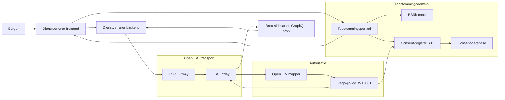
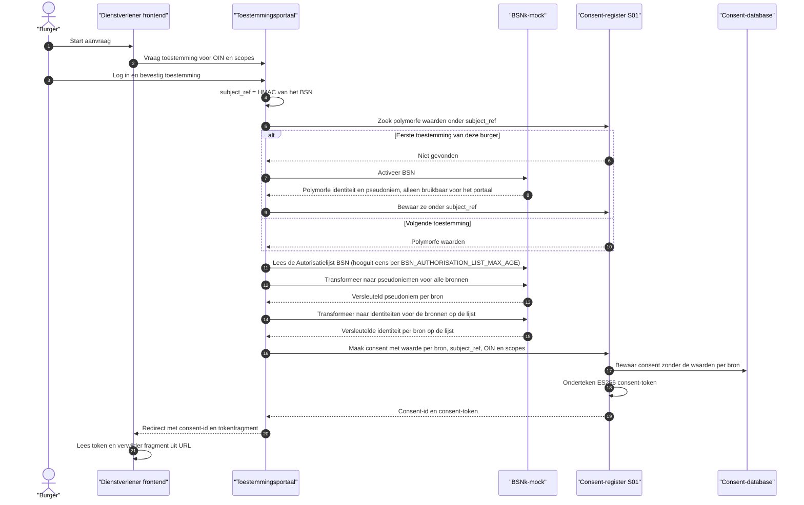
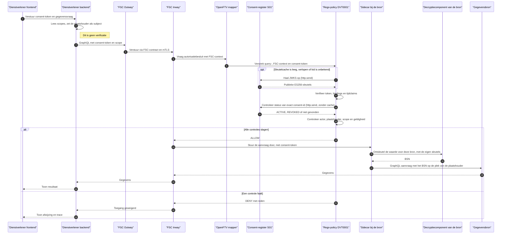
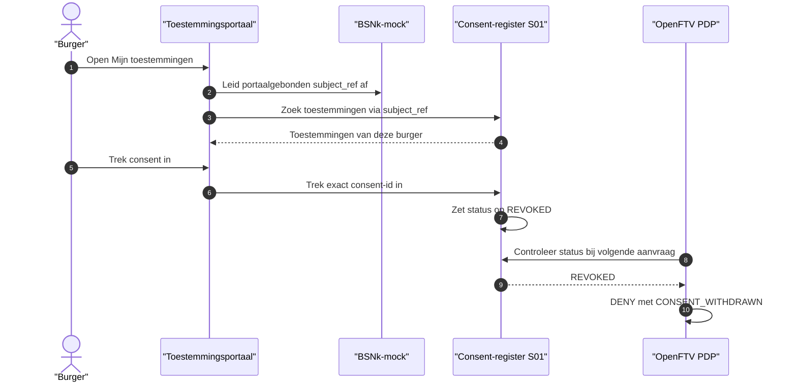

# DvTP-toestemmingsflow

Dit document beschrijft hoe een burger toestemming verleent, hoe een
dienstverlener die toestemming gebruikt en hoe intrekking onmiddellijk in het
autorisatiebesluit doorwerkt.

`S01` is de architectuurcode die in de demo voor het consent-register wordt
gebruikt. Het is geen afzonderlijke service naast het consent-register.

## Componenten



Het consent-token noemt de burger alleen in versleutelde waarden per bron: een
pseudoniem voor elke bron en een identiteit voor een bron op de
Autorisatielijst BSN. BSNk maakt ze voor het OIN van die bron, en alleen die
bron kan ze ontsleutelen. De dienstverlener krijgt geen identificator van de
burger. Het consent-register bewaart die waarden niet; ze worden tijdens het
aanmaken van het token kortstondig verwerkt. Voor burgergerichte listing en
ownership gebruikt het register een afzonderlijke, portaalgebonden
`subject_ref`.

Die `subject_ref` leidt het portaal zelf af: een HMAC van het BSN met een
geheime sleutel van het portaal (`SUBJECT_REF_KEY`). Hetzelfde BSN geeft altijd
dezelfde verwijzing, dus het portaal vindt een burger bij elke inlog terug
zonder BSNk. Onder die verwijzing bewaart het register ook de polymorfe
waarden uit de eerste activering. Het portaal activeert een burger dus één
keer, bij de eerste toestemming; bij elke volgende toestemming laat het die
waarden alleen nog transformeren. Bekijken en intrekken roepen BSNk niet aan.

## 1. Toestemming verlenen



Het token bevat de bindings waarop de PDP later beslist:

- `consent_id` en `jti`;
- `encrypted_subject`: per bron, onder haar OIN, een versleuteld pseudoniem
  (`pseudonym`) en, als de bron op de Autorisatielijst BSN staat, een
  versleutelde identiteit (`identity`), elk met de sleutelversie;
- scopes en optionele veldselecties;
- `dienstverlener_oin`;
- issuer, audience en geldigheid via `iat`, `nbf`, `exp` en `valid_until`.

De bestaande API-veldnaam `dienstverlener_oin` bevat in deze flow de FSC Peer
ID waarmee de PDP de token aan `subject.id` bindt, of, als een integrator
namens de dienstverlener verbindt, aan de delegator uit de FSC-verbinding (zie
[Integrator namens een dienstverlener](integrator.md)). De voorgedefinieerde
issuance-scenario's van het developer portal vullen dit veld vanuit
`DVTP_CONSUMER_PEER_ID`; alleen lokaal geldt bij ontbrekende configuratie de
default `99999999900000000300`. Handmatig ingevoerde en opgeslagen payloads
worden niet door deze configuratie overschreven.

Het portaal accepteert alleen `http`- en `https`-return-URL's waarvan de
exacte origin in de geconfigureerde allow-list staat. De image leest die bij
het starten van de container uit `ALLOWED_RETURN_ORIGINS`;
`VITE_ALLOWED_RETURN_ORIGINS` geldt alleen voor de Vite-devserver. Zonder
beide accepteert het portaal alleen `http://localhost:9001` (demo-shortcut),
dus een uitrol moet `ALLOWED_RETURN_ORIGINS` zetten. De token wordt in het
URL-fragment teruggegeven en direct uit de zichtbare URL verwijderd.

## 2. Toestemming gebruiken



De policy haalt het consent zelf op, tijdens de evaluatie (`http.send` vanuit
`policies/gbo/consent.rego`); de mapper verifieert en raadpleegt niets.
De JWKS wordt vijf minuten gecachet en direct opnieuw opgehaald bij een
onbekende `kid`. De status van het specifieke consent wordt bij iedere aanvraag
zonder cache online gecontroleerd, zodat een intrekking bij de eerstvolgende
aanvraag doorwerkt. JWT-tijdclaims hebben 30 seconden tolerantie voor
klokverschil. Elke aanroep heeft een timeout van twee seconden; een
onbereikbaar register levert een expliciete weigering op, geen ongedefinieerde
regel.

De policy geeft alleen `ALLOW` wanneer alle volgende relaties kloppen:

```text
geldige ondertekening en geregistreerde claims
+ consent bestaat, is ACTIVE en is nog geldig
+ FSC-delegator (anders subject.id) == dienstverlener_oin uit het token
+ bij delegatie: integrator gemandateerd voor die dienstverlener en regel
+ het subject in de GraphQL-query is een plaatshouder die de regel accepteert
+ de scope van de regel, gevraagde jaren en velden vallen binnen het consent
= ALLOW
```

De dienstverlener noemt het subject met een plaatshouder en niet met een eigen
waarde: het subject kan zo alleen de burger van het geverifieerde consent
zijn. De plaatshouder zegt welke vorm de API van de bron neemt:
`consent:identity` voor een API die een BSN neemt, `consent:pseudonym` voor
een API die het eigen pseudoniem van de bron neemt. Elke regel noemt de
plaatshouders die zijn API accepteert; een andere waarde wordt geweigerd met
`CONSTRAINT_MISMATCH`. `DVT0001` en `LVG0001` accepteren alleen
`consent:identity`; geen demobron neemt nog een pseudoniem aan.

Pas na de `ALLOW` zet de sidecar bij de bron het BSN of haar eigen pseudoniem
op de plek van de plaatshouder. De bron ontsleutelt daarvoor zelf de waarde
van die vorm die het token voor haar OIN draagt, met sleutels die ze vooraf
heeft gekregen en zonder BSNk aan te roepen. Als pseudoniem gebruikt de
sidecar de pseudoniemwaarde (`pseudonymValue`): die blijft gelijk als de bron
nieuwe sleutels krijgt. Een waarde die voor een andere
partij is gemaakt, accepteert de bron niet. Een bron die niet op de
Autorisatielijst BSN staat, heeft alleen een pseudoniem: een vraag naar haar
identiteit faalt bij de sidecar. Een aanvraag zonder consent-token (de EUDI-route) gaat ongewijzigd
door.

Dat de vervanging pas na de beslissing komt, hangt eraan dat alleen de Inway
de sidecar kan bereiken. In de demo zit de sidecar daarom alleen op een
netwerk met de Inways van de bronnen (`source-gateways`) en op een netwerk met
wat de bron bedient (`sources`), en publiceert hij geen poort. Een afnemer die
de sidecar rechtstreeks zou bereiken, sloeg de PDP over.

Ontbrekende, ongeldige of niet-beschikbare context faalt gesloten met een
gerichte reden, zoals `CONSENT_SIGNATURE_INVALID`, `CONSENT_TOKEN_EXPIRED`,
`CONSENT_CONTEXT_INVALID`, `CONSENT_KEYS_UNAVAILABLE`,
`CONSENT_ACTOR_MISMATCH`, `INTEGRATOR_NOT_REGISTERED`, `CONSTRAINT_MISMATCH`,
`CONSENT_STATUS_UNAVAILABLE` of `CONSENT_WITHDRAWN`.

## 3. Toestemming intrekken



Een ander actief consent voor dezelfde burger kan het ingetrokken consent niet
vervangen: de PDP controleert altijd uitsluitend het `consent_id` uit het
ondertekende token.

## 4. Gebruik van een toestemming inzien

Een burger ziet in MijnOverheid wanneer een toestemming is gebruikt: datum,
dienstverlener en bron (#687). Elke bron heeft een LDV-component
(`ldv-logboek` in proxymodus, #689) tussen haar Inway en haar sidecar. Die
legt elke levering onder een toestemming vast in een eigen logboek en meldt
de trace bij de toestemmingsgebruik-index (`consent-usage-index`) naast het
consent-register. Opent de burger het consent, dan zoekt het register de
registraties op en leest het elke trace terug bij de bron (#686).

```mermaid
sequenceDiagram
    autonumber
    actor Citizen as "Burger"
    participant IN as "Inway van de bron"
    participant LC as "LDV-component van de bron"
    participant SC as "Sidecar bij de bron"
    participant BOUT as "Outway van de bron"
    participant IDX as "Toestemmingsgebruik-index"
    participant Portal as "Toestemmingsportaal"
    participant Register as "Consent-register S01"
    participant CROUT as "cr-outway"

    IN->>LC: Aanvraag na de ALLOW (met consent-token)
    LC->>SC: Ongewijzigd doorgestuurd, in dezelfde trace
    SC-->>LC: 200 + Gbo-Ldv-Subject-Id
    LC->>LC: Record in eigen logboek (burger, geen consent)
    LC->>BOUT: POST /consent-usage-index/registrations
    BOUT->>IDX: logbook_id, trace_id, consent_id (via cr-inway)
    LC-->>IN: Gegevens, zonder de subjectheader

    Citizen->>Portal: Open het consent
    Portal->>Register: GET /consents/{id}/uses (na eigenaarscontrole)
    Register->>IDX: Registraties onder dit consent (intern)
    par per bron, met een timeout
        Register->>CROUT: POST /ldv-lezen-bd/data-processing-operations {traceId}
        CROUT->>IN: FSC; de PDP van de bron toetst LDV_READ_FSC
        IN->>LC: Leesfunctie (4018), beperkt antwoord
    end
    Register-->>Portal: Gebruik, en een melding per bron die niet te lezen is
```

### Het contract voor een bron

Een bron die onder een toestemming levert, plaatst de LDV-component voor haar
eigen dienst en richt haar FSC-dienst op de component. Ze bouwt er zelf
niets voor, behalve dat haar dienst de burger noemt in `Gbo-Ldv-Subject-Id`
(in de demo doet de sidecar dat met `LDV_RETURN_SUBJECT_ID=true`) en een
regel voor de leesfunctie in haar PDP-policy. De component meldt elke
levering via de Outway van de bron:

```http
POST /consent-usage-index/registrations
Content-Type: application/json

{"logbook_id": "99999999900000000200/ldv-lezen-bd",
 "trace_id": "4bf92f3577b34da6a3ce929d0e0e4736",
 "grondslag_type": "consent",
 "grondslag_ref": "<consent_id uit het token>"}
```

- `logbook_id` is de Peer ID van de bron, een schuine streep en de naam van
  de leesdienst van de component. De naam is nodig omdat BD en LVG een peer
  delen. De index weigert (403) een registratie voor een andere peer.
- `trace_id` is de trace van het record in het logboek van de component.
- De component meldt alleen na een `200` op een aanvraag met een
  consent-token, en pas nadat het record is vastgelegd. Lukt een van de twee
  niet, dan krijgt de afnemer `502` en geen gegevens.
- Een herhaling is veilig: de index antwoordt dan `200`.

Een bron zonder component kan de sidecar zelf laten melden
(`CONSENT_USAGE_INDEX_URL` en `CONSENT_USAGE_LOGBOOK_ID`); haar registraties
tellen dan als gebruik zonder terugleesactie, op het tijdstip van registratie.

### Wat telt als gebruik

Elk record dat het register onder de trace terugleest bij de component is
een gebruik, op de starttijd van dat record. Een registratie zonder record
geeft geen gebruik. Kan het register de index niet bereiken, dan toont de
pagina een melding in plaats van een lege lijst; kan het één bron niet
lezen, dan toont ze een melding voor die bron en het gebruik bij de andere
bronnen (besluit D2).

Het register legt het teruglezen vast als eigen verwerking
(`gbo-toestemming-gebruik-lezen`), met de burger als betrokkene en de namen
van de gelezen bronnen, zonder de trace-id's.

## Beveiligingsgrens

Het demo-token is een bearer-token. De actorbinding voorkomt dat een andere
FSC-consument het token gebruikt, maar maakt replay door dezelfde consument
niet onmogelijk. Een productie-implementatie moet daarom een kortere
tokenlevensduur en proof-of-possession aan de FSC- of mTLS-identiteit toevoegen.
