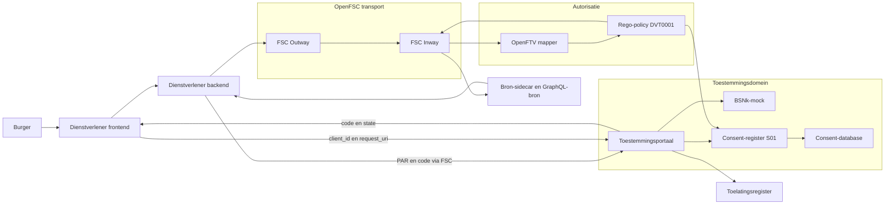
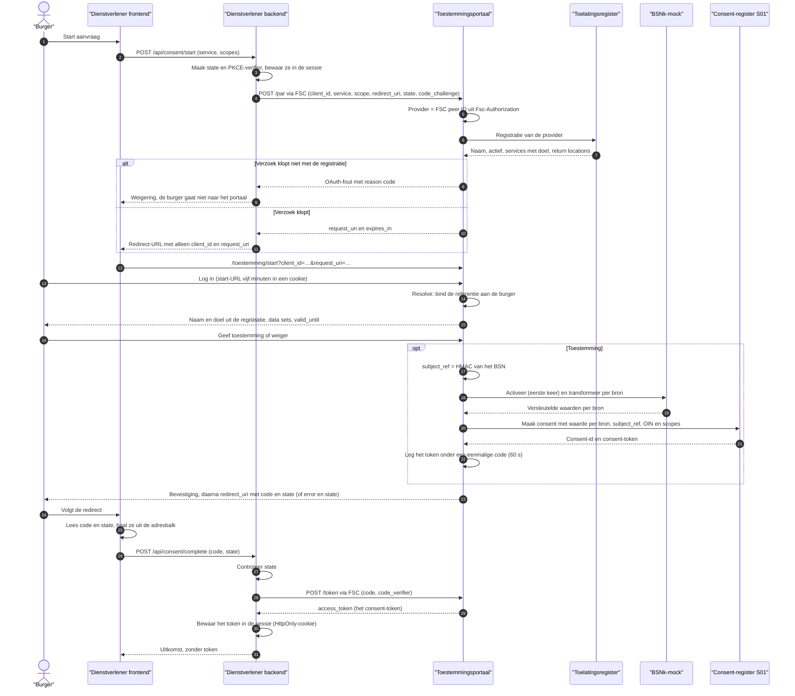
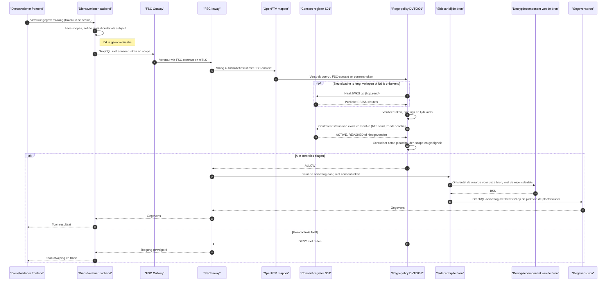
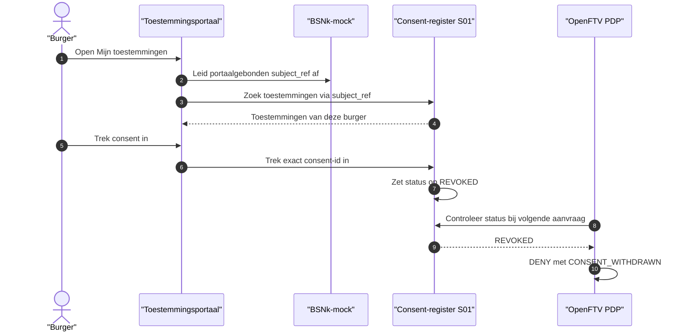

# DvTP-toestemmingsflow

Dit document beschrijft hoe een burger toestemming verleent, hoe een
dienstverlener die toestemming gebruikt en hoe intrekking onmiddellijk in het
autorisatiebesluit doorwerkt.

`S01` is de architectuurcode die in de demo voor het consent-register wordt
gebruikt. Het is geen afzonderlijke service naast het consent-register.

## Componenten



Het consent-token noemt de burger alleen in versleutelde waarden per bron: een
pseudoniem voor elke bron en een identiteit voor een bron op de
Autorisatielijst BSN. BSNk maakt ze voor het OIN van die bron, en alleen die
bron kan ze ontsleutelen. De dienstverlener krijgt geen identificator van de
burger. Het consent-register bewaart die waarden niet; ze worden tijdens het
aanmaken van het token kortstondig verwerkt. Voor burgergerichte listing en
ownership gebruikt het register een afzonderlijke, portaalgebonden
`subject_ref`.

Die `subject_ref` leidt het portaal zelf af: een HMAC van het BSN met een
geheime sleutel van het portaal (`SUBJECT_REF_KEY`). Hetzelfde BSN geeft altijd
dezelfde verwijzing, dus het portaal vindt een burger bij elke inlog terug
zonder BSNk. Onder die verwijzing bewaart het register ook de polymorfe
waarden uit de eerste activering. Het portaal activeert een burger dus één
keer, bij de eerste toestemming; bij elke volgende toestemming laat het die
waarden alleen nog transformeren. Bekijken en intrekken roepen BSNk niet aan.

## 1. Toestemming verlenen

De dienstverlener stuurt zijn verzoek niet via de browser maar server-side,
als pushed authorization request (PAR, RFC 9126) via FSC. De browser
draagt alleen het `client_id` en een kortlevende referentie (`request_uri`)
naar het portaal, en daarna een eenmalige code terug. De dienstverlener
wisselt die code via FSC in voor het consent-token, met zijn PKCE-verifier
(RFC 7636). Het token staat nooit in een URL of in browser storage.



De pseudonimisering is ongewijzigd: bij de eerste toestemming van een burger
activeert het portaal het BSN bij BSNk en bewaart het register de polymorfe
waarden onder `subject_ref`; bij elke toestemming leest het portaal de
Autorisatielijst BSN (hooguit eens per `BSN_AUTHORISATION_LIST_MAX_AGE`) en
laat het de waarden per bron transformeren. Het register bewaart het consent
zonder die waarden en ondertekent het token met ES256.

Dit wijkt af van figuur 4 van het Globaal Ontwerp, waar de dienstverlener
scope en doelbinding in de redirect meegeeft en de toestemmingsvoorziening
het consent-id en de versleutelde waarden via een redirect terugstuurt: in de
demo gaat het verzoek server-side via FSC en gaat alleen een eenmalige code
door de browser.

### Weigeringen en uitkomsten

Het portaal controleert het verzoek bij PAR tegen de registratie van de
provider in het toelatingsregister, in deze volgorde. Een geweigerd verzoek
bereikt de burger niet.

| Moment | HTTP | `error` | `reason` | Wanneer |
| --- | --- | --- | --- | --- |
| PAR | 401 | `invalid_client` | | Geen `Fsc-Authorization` |
| PAR | 413 | `invalid_request` | `INITIATION_INCOMPLETE` | De body is groter dan 64 KiB |
| PAR | 400 | `invalid_request` | `INITIATION_INCOMPLETE` | De body is niet `application/x-www-form-urlencoded`, een parameter komt meer dan eens voor, of de body bevat een `request_uri` |
| PAR | 400 | `invalid_request` | `INITIATION_INCOMPLETE` | Verplicht veld ontbreekt (`response_type=code`, `client_id`, `service`, `scope`, `redirect_uri`, `state`, `code_challenge` met `S256`), of `valid_until` is ongeldig |
| PAR | 400 | `unauthorized_client` | `PARTY_NOT_ACTIVE` | De peer is niet toegelaten of niet actief |
| PAR | 400 | `invalid_request` | `INITIATION_MISMATCH` | `client_id` is niet de FSC peer die pusht, de service is niet bij de provider geregistreerd, of `client_name` of `purpose` wijkt af van de registratie |
| PAR | 400 | `invalid_scope` | `UNKNOWN_SCOPE` | Een onbekende data set |
| PAR | 400 | `invalid_request` | `RETURN_URL_NOT_REGISTERED` | `redirect_uri` is geen geregistreerde return location (exacte vergelijking) |
| PAR | 503 | `temporarily_unavailable` | `ADMISSION_REGISTER_UNAVAILABLE` | Het toelatingsregister is niet bereikbaar (fail closed) |
| Resolve | 404 | | `REQUEST_URI_UNKNOWN` | Onbekende referentie |
| Resolve | 410 | | `REQUEST_URI_EXPIRED` | Verlopen referentie (`PAR_REQUEST_LIFETIME`, standaard 10 minuten) |
| Resolve | 410 | | `REQUEST_URI_SPENT` | Referentie al gebruikt voor een beslissing |
| Resolve | 400 | | `CLIENT_ID_MISMATCH` | `client_id` in de URL is niet de provider die de referentie pushte |
| Resolve | 403 | | `REQUEST_URI_OTHER_CITIZEN` | Referentie is al aan een andere burger gebonden |
| Beslissing | 403 | | `REQUEST_URI_NOT_RESOLVED` | Beslissing zonder voorafgaande resolve |
| `/token` | 401 | `invalid_client` | | Geen `Fsc-Authorization` |
| `/token` | 413 | `invalid_request` | | De body is groter dan 64 KiB |
| `/token` | 400 | `invalid_request` | | De body is niet `application/x-www-form-urlencoded`, een parameter komt meer dan eens voor, `grant_type`, `code` of `redirect_uri` ontbreekt, of `client_id` is niet de FSC peer die aanroept |
| `/token` | 400 | `unsupported_grant_type` | | Een andere `grant_type` dan `authorization_code` |
| `/token` | 400 | `invalid_grant` | | Code onbekend, al ingewisseld, ouder dan 60 seconden, van een andere provider, met een andere `redirect_uri` dan in het verzoek, of met een verkeerde `code_verifier` |

Bij een geweigerde referentie toont het portaal één foutpagina, zonder link
en zonder redirect. Na een beslissing gaat de burger naar de geregistreerde
return location:

| Beslissing | Return-URL | Uitkomst bij de provider |
| --- | --- | --- |
| Toestemming | `?code=…&state=…` | `granted`; het token staat in de sessie van de provider-backend |
| Geweigerd | `?error=access_denied&state=…` | `denied`; geen consent |
| Consent maken mislukt | `?error=server_error&state=…` | `failed` |

### Demo shortcuts

- De registratie van providers (services, doel, return locations) staat in de
  config van het toelatingsregister, niet in zijn database. Een echte
  uitrol beheert die in het register of een dienstencatalogus.
- consent-portal-backend leest het toelatingsregister rechtstreeks over het
  Docker-netwerk `dvtp-onboarding`, zonder eigen read-listener of mTLS.
- Request store en code store zijn in-memory, met één replica: een herstart
  laat open verzoeken en codes vervallen.
- De FSC-listener van het portaal (`/par`, `/token`) vertrouwt
  `Fsc-Authorization` zonder de handtekening te verifiëren, en is net als
  `consent-status` ook zonder `cr-inway` bereikbaar op de netwerken
  `fsc-infra` en `backend`. Een echte uitrol verifieert het token of zet
  mTLS tussen Inway en service.
- De bekende data sets zijn backend-config naast de teksten van de portal.
- De portal-login (mock-DigiD) is een bearer-token in `sessionStorage`; een
  echte uitrol houdt de sessie van de burger server-side achter een
  HttpOnly-cookie.
- `valid_until` wordt niet tegen de registratie gecontroleerd, en een provider
  die tussen PAR en beslissing wordt gedeactiveerd, krijgt binnen de looptijd
  van het verzoek nog een consent.
- De sessies van de provider-backends zijn in-memory. In de demo draaien alle
  frontends op één host, dus de browser stuurt de sessiecookie van elke
  provider naar de `/api`-proxy van elke frontend; een echte uitrol geeft
  elke provider een eigen origin.
- De directe `POST /portal/consents` blijft bestaan als developer-API (token
  in het antwoord, doel uit het verzoek); het developer portal en de
  integrator gebruiken die. Die API slaat de toelatingscontroles van het
  pushed request over: ook een inactieve of niet-geregistreerde
  dienstverlener krijgt er een consent mee, en wie een portal-login heeft,
  kan er via de `/portal-api`-proxy van het portaal een token voor elke
  `dienstverlener_oin` mee laten maken. Het developer portal bewaart de
  tokens die het zo krijgt in `sessionStorage`. De belofte hierboven dat het
  token nooit in een URL of in browser storage staat, geldt dus voor de
  stroom van de dienstverlener, niet voor deze API. Een echte uitrol heeft
  zo'n endpoint niet voor tokens van burgers, of beperkt het tot de
  ontwikkelomgeving.

Het token bevat de bindings waarop de PDP later beslist:

- `consent_id` en `jti`;
- `encrypted_subject`: per bron, onder haar OIN, een versleuteld pseudoniem
  (`pseudonym`) en, als de bron op de Autorisatielijst BSN staat, een
  versleutelde identiteit (`identity`), elk met de sleutelversie;
- scopes en optionele veldselecties;
- `dienstverlener_oin`;
- issuer, audience en geldigheid via `iat`, `nbf`, `exp` en `valid_until`.

De bestaande API-veldnaam `dienstverlener_oin` bevat in deze flow de FSC Peer
ID waarmee de PDP de token aan `subject.id` bindt, of, als een integrator
namens de dienstverlener verbindt, aan de delegator uit de FSC-verbinding (zie
[Integrator namens een dienstverlener](integrator.md)). De voorgedefinieerde
issuance-scenario's van het developer portal vullen dit veld vanuit
`DVTP_CONSUMER_PEER_ID`; alleen lokaal geldt bij ontbrekende configuratie de
default `99999999900000000300`. Handmatig ingevoerde en opgeslagen payloads
worden niet door deze configuratie overschreven.

## 2. Toestemming gebruiken



De policy haalt het consent zelf op, tijdens de evaluatie (`http.send` vanuit
`policies/gbo/consent.rego`); de mapper verifieert en raadpleegt niets.
De JWKS wordt vijf minuten gecachet en direct opnieuw opgehaald bij een
onbekende `kid`. De status van het specifieke consent wordt bij iedere aanvraag
zonder cache online gecontroleerd, zodat een intrekking bij de eerstvolgende
aanvraag doorwerkt. JWT-tijdclaims hebben 30 seconden tolerantie voor
klokverschil. Elke aanroep heeft een timeout van twee seconden; een
onbereikbaar register levert een expliciete weigering op, geen ongedefinieerde
regel.

De policy geeft alleen `ALLOW` wanneer alle volgende relaties kloppen:

```text
geldige ondertekening en geregistreerde claims
+ consent bestaat, is ACTIVE en is nog geldig
+ FSC-delegator (anders subject.id) == dienstverlener_oin uit het token
+ bij delegatie: integrator gemandateerd voor die dienstverlener en regel
+ het subject in de GraphQL-query is een plaatshouder die de regel accepteert
+ de scope van de regel, gevraagde jaren en velden vallen binnen het consent
= ALLOW
```

De dienstverlener noemt het subject met een plaatshouder en niet met een eigen
waarde: het subject kan zo alleen de burger van het geverifieerde consent
zijn. De plaatshouder zegt welke vorm de API van de bron neemt:
`consent:identity` voor een API die een BSN neemt, `consent:pseudonym` voor
een API die het eigen pseudoniem van de bron neemt. Elke regel noemt de
plaatshouders die zijn API accepteert; een andere waarde wordt geweigerd met
`CONSTRAINT_MISMATCH`. `DVT0001` en `LVG0001` accepteren alleen
`consent:identity`; geen demobron neemt nog een pseudoniem aan.

Pas na de `ALLOW` zet de sidecar bij de bron het BSN of haar eigen pseudoniem
op de plek van de plaatshouder. De bron ontsleutelt daarvoor zelf de waarde
van die vorm die het token voor haar OIN draagt, met sleutels die ze vooraf
heeft gekregen en zonder BSNk aan te roepen. Als pseudoniem gebruikt de
sidecar de pseudoniemwaarde (`pseudonymValue`): die blijft gelijk als de bron
nieuwe sleutels krijgt. Een waarde die voor een andere
partij is gemaakt, accepteert de bron niet. Een bron die niet op de
Autorisatielijst BSN staat, heeft alleen een pseudoniem: een vraag naar haar
identiteit faalt bij de sidecar. Een aanvraag zonder consent-token (de EUDI-route) gaat ongewijzigd
door.

Dat de vervanging pas na de beslissing komt, hangt eraan dat alleen de Inway
de sidecar kan bereiken. In de demo zit de sidecar daarom alleen op een
netwerk met de Inways van de bronnen (`source-gateways`) en op een netwerk met
wat de bron bedient (`sources`), en publiceert hij geen poort. Een afnemer die
de sidecar rechtstreeks zou bereiken, sloeg de PDP over.

Ontbrekende, ongeldige of niet-beschikbare context faalt gesloten met een
gerichte reden, zoals `CONSENT_SIGNATURE_INVALID`, `CONSENT_TOKEN_EXPIRED`,
`CONSENT_CONTEXT_INVALID`, `CONSENT_KEYS_UNAVAILABLE`,
`CONSENT_ACTOR_MISMATCH`, `INTEGRATOR_NOT_REGISTERED`, `CONSTRAINT_MISMATCH`,
`CONSENT_STATUS_UNAVAILABLE` of `CONSENT_WITHDRAWN`.

## 3. Toestemming intrekken



Een ander actief consent voor dezelfde burger kan het ingetrokken consent niet
vervangen: de PDP controleert altijd uitsluitend het `consent_id` uit het
ondertekende token.

## Beveiligingsgrens

Het demo-token is een bearer-token. De actorbinding voorkomt dat een andere
FSC-consument het token gebruikt, maar maakt replay door dezelfde consument
niet onmogelijk. Een productie-implementatie moet daarom een kortere
tokenlevensduur en proof-of-possession aan de FSC- of mTLS-identiteit toevoegen.
